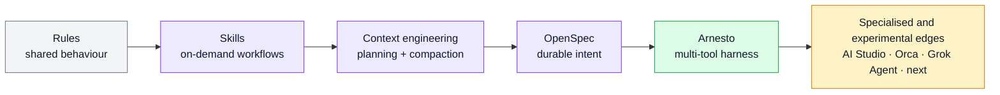
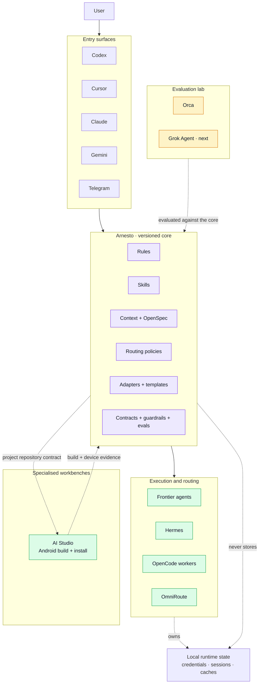

<h1 align="center">Arnesto</h1>

<p align="center">
  <strong>The agent harness that got out of hand.</strong><br>
  Personal by design, public as a reference, and never quite finished.
</p>

<p align="center">
  <a href="https://github.com/saski/arnesto/actions/workflows/check.yml"></a>
  <a href="https://github.com/saski/arnesto/blob/main/LICENSE"></a>
  
</p>

Arnesto is the versioned operating layer behind my AI-assisted work. It brings
together instructions, executable tools, agent contracts, routing policies,
evaluations, and local wiring so that different coding agents can share one
coherent way of working.

It is not a universal agent framework or a polished distribution. It is a
working system shaped around my environment, published so other people can
inspect it, borrow from it, and adapt the useful pieces to their own stack.

Read [how I organise my agent environment](https://www.saski.com/notes/arnesto/)
for concrete examples of rules, skills, context and runtime boundaries.
More writing lives in [Notes on saski.com](https://www.saski.com/notes/).

## Current state

Repository review: **2026-10-16**. This describes checked-in mechanisms and
documented experiments; provider health and installed runtime state require
their own live checks.

| Area | What exists today | What remains open |
|---|---|---|
| Portable core | Progressive rules, shared skills, commands, OpenSpec, setup contracts, and local/CI validation | Keep client wiring and imported material aligned as tools change |
| Agent execution | A frontier-owned handoff to a constrained OpenCode worker, with model admission, execution limits, structured results, and local validation | Complete the shared multi-entry contract, including Cursor, a portable Hermes profile, and final acceptance evidence |
| Runtime integration | Separate Codex/Orca runtimes, Hermes remote entry, OmniRoute configuration, and explicit free-model lanes | Recheck volatile routes; configuration and past probes do not establish current availability |
| Behavioural evaluation | Truthfulness cases and a pinned Promptfoo evaluator; one recorded Promptfoo case passed | Broader model/client comparisons and representative quality, cost, and correction measurements |
| Optional tools | Ponytail reuse guidance, CodeGraph navigation, and a Headroom compression fixture | Real-task benefit and integration quality remain unproven; these do not change global routing |
| Experimental surfaces | A documented AI Studio Android build/install workflow and an Orca trial | Orca acceptance evidence; Grok Agent remains a planned evaluation |

The [project status](PROJECT_STATUS.md) and
[active routing tasks](docs/openspec/changes/codex-led-agent-routing/tasks.md)
record the remaining work. The reusable coordination mechanism is
[`run-free-worker`](.agents/skills/free-agent-execution/scripts/run-free-worker);
the [archived provisional coordinator](docs/free-worker-coordination/README.md#provisional-launcher-reference)
is reference material.

## Why “Arnesto”?

**Arnesto** takes its cue from the Spanish word *arnés* —harness—.
The name fits what the repository became: no longer a collection of
configuration files, but the harness connecting an increasingly unruly set
of tools.

## How it got here

The repository started in Q3 2025 as a fork of a coding-agent configuration.
Each generation of tools changed what the repository needed to hold:



That evolution is the point. Arnesto preserves the stable lessons while
letting models, clients, and orchestration experiments change around them.

## The shape of the harness



The repository owns portable intent and repeatable behaviour. Each tool keeps
its credentials, sessions, databases, trust state, and mutable preferences in
its own runtime. The diagram groups responsibilities; client availability does
not mean every client has completed the shared entry contract. Arnesto is the
versioned core, and the user remains the actor above it.

AI Studio is a specialised workbench rather than another control plane. The
Health tracking project validated a narrow workflow in which Codex and OpenSpec
owned requirements, source changes, tests, and review in a canonical GitHub
repository, while AI Studio synchronised that repository, built the Android
app, and installed it on the phone. This preserved an auditable source of truth
without requiring a local Android Studio, SDK, or ADB setup.

## What is stable, and what moves

| Stable core | Specialised and experimental edge |
|---|---|
| Compact rules loaded progressively | Model and provider availability |
| Skills selected only when relevant | Routing combinations |
| OpenSpec for durable requirements and decisions | New entry surfaces and agent clients |
| Canonical repositories and review boundaries | AI Studio as an Android build and install workbench |
| Explicit runtime and credential boundaries | Orca evaluation |
| Behaviour-level contracts and `make check` | Grok Agent as the next exploration |

An experiment is not promoted because it looks interesting. It must solve a
real problem, respect the existing boundaries, and survive a useful task with
observable evidence.

## Artifact categories

An artifact's category describes its job, not necessarily its directory. A
skill can bundle a script, an agent prompt, fixtures, and references. A policy
states what is permitted; a guardrail is the mechanism that checks or limits
execution. An instruction alone does not provide that enforcement.

### Instructions and durable context

| Category | Purpose | Current examples and boundaries |
|---|---|---|
| **Rules** | Define baseline behaviour and when to load narrower instructions | [`.agents/rules/`](.agents/rules), exposed through client instruction files. Most are guidance interpreted by the agent; Codex's `codex-default.rules` is a separate client-specific command approval file. |
| **Skills** | Supply a reusable workflow only when the task needs it | [`.agents/skills/`](.agents/skills) is the shared library; [Cursor-only skills](.agents/docs/cursor-skills.md) have a separate inventory. Availability depends on client discovery and setup. |
| **Commands and workflows** | Provide explicit entry points and repeatable sequences | [`.agents/commands/`](.agents/commands) and [`.agents/workflows/`](.agents/workflows). They describe procedures; they are not background jobs. |
| **Specifications, plans, and research** | Preserve requirements, decisions, tasks, and working context | [`docs/openspec/`](docs/openspec), the `thoughts/` workspace, and its [`src/thoughts/`](src/thoughts) CLI. Active proposals, archived decisions, and accepted behaviour have different status. |
| **Catalogs and provenance** | Make capabilities discoverable and track ownership, source pins, and licenses | [Domain routing](.agents/docs/skill-domain-routing.md), [skill inventory](.agents/docs/skill-factory-skills.md), [governance catalogs](.agents/skills/skill-foundry/agents), [`skills-lock.json`](skills-lock.json), and [upstream locks](.agents/upstreams). These describe inventory and origin, not measured effectiveness. |

### Execution and integration

| Category | Purpose | Current examples and boundaries |
|---|---|---|
| **Scripts and CLIs** | Perform deterministic operations | [`bin/`](bin), root setup/sync/validation scripts, and skill-local `scripts/`. A script performs work; its calling skill explains when and how to use it. |
| **Agents and roles** | Define an executor's responsibility, tools, limits, and handoff | The [OpenCode worker profile](templates/opencode/free-worker.jsonc) and [frontier/entry/worker contract](.agents/skills/free-agent-execution/SKILL.md) are implemented. Skill-local worker/reviewer prompts also exist; there is no general agent registry or universal scheduler. |
| **Adapters and tool connections** | Translate a contract into a client or tool invocation | [`run-free-worker`](.agents/skills/free-agent-execution/scripts/run-free-worker), [`codex-free`](bin/codex-free), and [MCP declarations](.agents/mcp.json). Shared MCP setup targets Cursor/Gemini; Codex owns its separate configuration. Declarations do not implement the external services. |
| **Gateways** | Provide messaging ingress or model/provider access | [Hermes and OmniRoute](docs/hermes-omniroute-operations.md) run outside the repository. Arnesto versions overlays, wrappers, and operating procedures; each gateway owns its credentials and mutable service state. |
| **Templates and wiring** | Install portable defaults while preserving local configuration | [`templates/`](templates) and [`setup-symlinks.sh`](setup-symlinks.sh). Shared assets are linked; selected mutable configuration is seeded or merged, with local Codex model/effort choices preserved. |
| **Hooks and operational automation** | React to tool or repository events and maintain local services | The [RTK hook](.agents/hooks/rtk-rewrite.sh), [pre-commit hook](hooks/pre-commit), and [Hermes watcher/update procedures](docs/hermes-omniroute-operations.md). RTK reduces shell output; it does not enforce task privacy. |

### Control and evidence

| Category | Purpose | Current examples and boundaries |
|---|---|---|
| **Policies and routing** | Decide eligible work, models, privacy categories, and execution ceilings | [Free-worker manifest](.agents/free-agent-routing.json), [Codex routing guidance](.agents/skills/codex-model-routing/SKILL.md), and [OmniRoute desired state](templates/omniroute/free-coding-combo.json). Advisory selection, adapter admission, and gateway fallback are separate decisions. |
| **Contracts and schemas** | Define valid inputs, outputs, roles, and failure semantics | [Worker contracts](.agents/skills/free-agent-execution/SKILL.md), executable `jq` checks, [OpenSpec specs](docs/openspec/specs), and Promptfoo's JSON Schema assertion. There is no central schema registry. |
| **Guardrails** | Apply checks and limits at specific execution boundaries | The adapter checks model admission and declared sensitivity, denies worker shell/delegation tools, applies limits, and checks newly dirty paths and validation results. `allowed_files` is a post-run check, not filesystem isolation; pre-existing dirty paths limit attribution. |
| **Tests and evaluations** | Verify mechanisms and sample agent behaviour | [`tests/`](tests), [`evals/`](evals), and [`make check`](Makefile). Local checks exercise contracts; live model evaluations run separately and consume provider quota. A passing fixture or one model case does not establish broad quality or safety. |
| **Runbooks, execution evidence, and observability** | Explain operation and preserve results that can be reviewed | [`docs/`](docs), structured worker results with usage/termination/validation fields, and [project-owned coordination evidence](docs/free-worker-coordination/README.md). Raw run material stays in the project's ignored `.lab/coordination/`; Arnesto has no unified audit or telemetry service. |

Credentials, sessions, caches, trust databases, and personal memory are
runtime-owned state rather than portable repository artifacts. Reusable task
recipes and selected evidence belong to the project that owns the work.

### Areas still to develop

These are candidate gaps to address when a real task justifies them, not
implemented capabilities or commitments to build another platform.

| Area | Next useful step |
|---|---|
| **Agent capability and handoff definitions** | Complete the existing entry contract before deciding whether reusable role manifests need a registry. Make tools, ownership, escalation, and acceptance explicit. |
| **Authorization and tool trust** | Map each policy to its actual enforcement point. Evaluate coverage for untrusted tool/document content, sensitive data, and side effects; retain human approval where required. |
| **Execution isolation and recovery** | Improve attribution on already-dirty files, precise file permissions, interruption recovery, and rollback. Current post-run checks cannot prevent or undo every out-of-scope write. |
| **Behavioural and routing evaluation** | Expand representative cases across clients and models, including abstention and provider failures. Measure accepted outcomes, retries, correction effort, time, and consumption before automatic routing. |
| **Observability and evidence lifecycle** | Correlate task, policy decision, execution, review, and result with minimal metadata; define redaction, retention, and resumable evidence before adding dashboards. |
| **Distribution and compatibility** | Track client/plugin versions, provenance, upgrades, deprecation, and installation drift. Promote optional integrations only after a bounded, repeatable task demonstrates value. |

The full skill inventory deliberately stays out of this README. Discovery
belongs to the active client and the domain routing catalog, not to a giant
prompt loaded on every task.

For explicit Codex model, reasoning effort, Fast mode, or spending decisions,
use [codex-model-routing](.agents/skills/codex-model-routing/SKILL.md). It provides
cost-conscious recommendations with acceptance checks and escalation criteria.

For Madrid municipal incidents, use
[madrid-avisos](.agents/skills/madrid-avisos/SKILL.md) to prepare a report, submit
it with authorization through an available browser, or check its status. See
[setup and validation notes](docs/madrid-avisos.md) for client availability.

## Explore or adapt it

Start by reading the repository before installing anything. The setup script
creates links under your home directory and seeds selected local templates.

```bash
git clone https://github.com/saski/arnesto.git
cd arnesto
make ci-check
```

If the conventions fit your environment, install the managed links and run the
complete local validation:

```bash
./setup-symlinks.sh setup
make check
```

My local SSH remote uses the `saski` host alias:

```text
git@github.com-saski:saski/arnesto.git
```

The setup recreates local shims such as `~/.agents/bin/openspec`; mutable
runtime state remains outside the repository. Forking and removing the pieces
that do not match your tools is an expected way to use Arnesto.

The explicit Codex/Orca lane uses the tracked OmniRoute `free-coding` route
through `codex-free`. The OpenCode entry configuration selects
`omniroute/combo/free-coding-v2`, and the Hermes overlay defaults to
`combo/free-coding-v2`. The v2 combo's membership and selection policy are local
OmniRoute state. These entry aliases do not expand the bounded worker
adapter's separate [model allowlist](.agents/free-agent-routing.json).
Fixed Laguna, MiMo, HY3, and Big Pickle pins remain available for Codex diagnosis.
See the
[runtime-boundary guide](docs/codex-orca-runtime-boundary.md) for configuration
and the data-safety boundary. The older `free-stack` and `free-deterministic`
combos are retired and must not be recreated.

## Where to go next

- [Coordination artifacts](docs/free-worker-coordination/README.md) — project-owned
  recipes and evidence, local execution logs, and a provisional launcher reference.
- [Architecture snapshot](docs/local-agentic-development-architecture.md) —
  architectural boundaries recorded on 2026-08-19; use current templates and
  routing tasks for subsequent configuration and acceptance changes.
- [Development guide](docs/development-guide.md) — repository structure,
  skill governance, setup, and validation.
- [Promptfoo evaluation](docs/development-guide.md#promptfoo-behavioral-evaluation)
  — check that Arnesto reports unexecuted validation honestly.
- [Promptfoo skill](.agents/skills/promptfoo-evals/SKILL.md) — choose and design
  behavioral evaluations for prompts, agent rules, and models.
- [TypeSafe AI skill](.agents/skills/typesafe-ai/SKILL.md) — design and build
  applications with TypeSafe's typed AI judgments using current vendor docs.
- [Token-efficiency tools](docs/token-efficiency-tools.md) — existing RTK and
  Caveman coverage, scoped Ponytail guidance, and optional CodeGraph/Headroom
  integrations with bounded local verification.
- [Hermes, OmniRoute, and Telegram operations](docs/hermes-omniroute-operations.md)
  — the current remote-entry runbook.
- [Runtime boundaries](docs/codex-orca-runtime-boundary.md) — why Codex, Orca,
  Hermes, and OmniRoute keep separate mutable state.
- [Project status](PROJECT_STATUS.md) — what is stable, under evaluation, and
  deliberately deferred now.

## Design principles

1. Keep universal instructions small.
2. Load specialised knowledge only when the task needs it.
3. Preserve intent and decisions outside transient chat context.
4. Prefer explicit routing and visible failure over magical fallback.
5. Keep credentials and mutable runtime state with the tool that owns them.
6. Promote experiments only after they earn a place in the stable core.

## Provenance

Arnesto grew from
[Eduardo Ferro's augmented-code configuration](https://github.com/eferro/augmentedcode-configuration).
The complete Git history preserves that origin. The former fork remains
archived as a public migration and provenance record.

## License

[Unlicense](LICENSE) — public domain.
